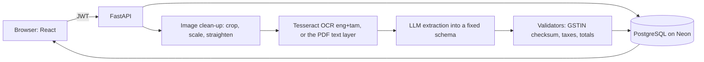

# GST Invoice Extractor


Turn a photo or PDF of an Indian GST bill (including bills with Tamil text) into validated,
structured data that a person can review, correct, and export.

**Live demo:** <<your Vercel link>> (the free backend sleeps when idle, so the first request can take about a minute)
**Demo video:** <<link>>


## The idea

OCR and LLMs both make mistakes on faded receipts and phone photos. So the **AI only reads;
deterministic code decides what to trust.** Every extracted value passes through checks
(GSTIN checksum, tax and total arithmetic, dates). Anything that doesn't add up is highlighted
with a reason, and a person compares it with the original bill before verifying.

## How it works



1. **Upload** a photo (phone camera supported), PNG, WebP, or PDF. Large photos are shrunk in the browser.
2. **Preprocessing:** crop to the paper, resize so characters are a readable size, remove shadows, straighten.
3. **OCR:** Tesseract with English and Tamil data. Digital PDFs use their exact text layer.
4. **Extraction:** an LLM returns JSON that is validated and bounded before anything is stored.
5. **Validation:** GSTIN format, state code and checksum; line-item arithmetic; items against subtotal;
   CGST against SGST; plausible tax rate; total including round-off; date sanity.
6. **Review:** original bill beside editable fields, flagged fields highlighted, Save re-runs the checks.
7. **Verify and export:** a person verifies, then exports CSV (Excel-ready UTF-8).

## Results

Evaluated on <<N>> bills (<<A>> synthetic phone-style photos, <<B>> clean synthetic invoices,
<<C>> real receipts including Tamil text). Real-bill results are reported separately because synthetic
bills flatter the pipeline.

| Group                       | GSTIN, date and total right | Every number right | Wrong-number bills flagged | False error flags |
| --------------------------- | --------------------------- | ------------------ | -------------------------- | ----------------- |
| Synthetic photos            | <<>>                        | <<>>               | <<>>                       | <<>>              |
| Real receipts (<<C>> bills) | <<>>                        | <<>>               | <<>>                       | <<>>              |

Validator stress test: <<M>> OCR-style mistakes injected into <<K>> clean invoices; <<Z>>% caught overall,
including 100% of GSTIN character misreads and lost decimal points. Mistakes that leave the invoice internally
consistent (a vendor-name typo, a plausible wrong year) cannot be caught by arithmetic. That is what the review
screen is for.

Image preprocessing and model comparison: <<one sentence each, from your eval/results files>>.

## Tech stack

- **Backend:** FastAPI, SQLAlchemy 2, Alembic, PostgreSQL (Neon), JWT auth, pytest (<<N>> tests)
- **AI:** Tesseract (English + Tamil), OpenCV, PyMuPDF, an OpenAI-compatible LLM API (Groq), Pydantic
- **Frontend:** React (Vite), Tailwind CSS, TanStack Query, React Hook Form
- **DevOps:** Docker, GitHub Actions, Render (API), Vercel (web)

## Run it locally

```bash
# backend
cd backend
python -m venv .venv && source .venv/bin/activate    # Windows: .venv\Scripts\Activate.ps1
pip install -r requirements.txt
cp .env.example .env        # fill in DATABASE_URL, SECRET_KEY and the LLM settings
alembic upgrade head
uvicorn app.main:app --reload

# frontend (second terminal)
cd frontend
npm install
cp .env.example .env
npm run dev

# or everything in containers
docker compose up --build   # web on :8080, API on :8000
```

Tesseract must be installed with the `eng` and `tam` language packs.

## Tests

`python -m pytest` in `backend/` and `npm test` in `frontend/`. Both run in CI.
`python -m scripts.evaluate` measures end-to-end accuracy, and `python -m scripts.validator_stress`
measures how many injected mistakes the validators catch.

## Known limits

- Tesseract reads Tamil item names poorly, so item names are the weakest field.
- The free hosting sleeps when idle, and **uploaded images are lost when the service restarts**
  (extracted data is kept in the database). Next step: S3-compatible object storage.
- The evaluation set is small, and the crop and text-size settings were tuned on a handful of photos.
- Background work runs inside the API process. A job queue with retries is the next step for real traffic.
- Tokens live in `localStorage`, which is simple but readable by injected scripts. An httpOnly cookie is stronger.
